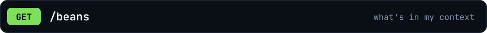
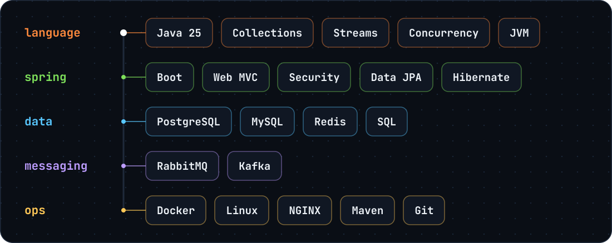
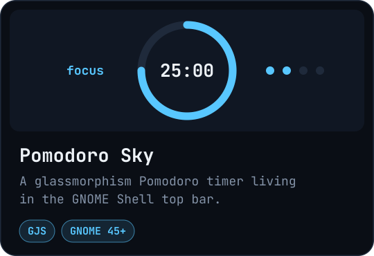
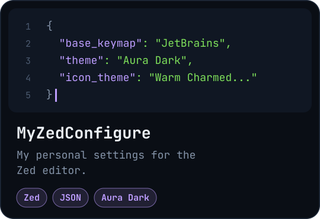
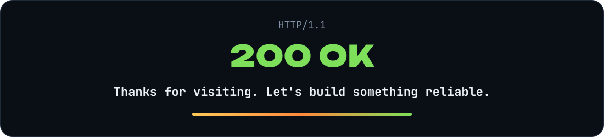

&nbsp;&nbsp;

  

  

<b>What I focus on, layer by layer</b>

 

| Layer | Topics |
|---|---|
| **Java** | OOP · Collections · Generics · Streams · Exceptions · Multithreading · JVM |
| **Spring Core** | IoC · DI · Beans · Configuration · Component Scanning · Bean Lifecycle |
| **Spring Web** | MVC · REST · Validation · Exception Handling · HTTP |
| **Persistence** | JPA · Hibernate · Entity Lifecycle · Persistence Context · Lazy Loading |
| **Transactions** | `@Transactional` · ACID · Propagation · Isolation · Rollback |
| **Security** | Spring Security · JWT · Authentication · Authorization |
| **Database** | PostgreSQL · MySQL · SQL · Indexes · Query Optimization |
| **Observability** | Spring Actuator · Application Metrics · Health Checks |

 

  

  

