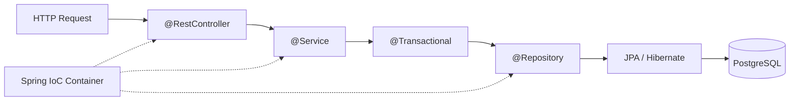

<div align="center">



### Java Backend Engineer

**Java 25 · Spring Boot · Spring Security · JPA / Hibernate · PostgreSQL · REST APIs**

<a href="https://www.linkedin.com/in/seyedrezabibak/">
  
</a>
<a href="mailto:seyedrezabibak@gmail.com">
  
</a>

</div>

---

## `~/java/backend`

I build backend applications with **Java and Spring Boot**, with a strong interest in what happens underneath the annotations: dependency injection, transactions, persistence, HTTP, concurrency and database behavior.

> **My goal:** write backend systems that are predictable, testable, maintainable and easy to operate.

```java
@RestController
@RequiredArgsConstructor
@RequestMapping("/api")
class DeveloperController {

    private final BackendService backend;

    @GetMapping("/hello")
    ResponseEntity<String> hello() {
        return ResponseEntity.ok(backend.build());
    }
}
```

---

## `spring.context`

The part of Spring I enjoy most is understanding the path from an HTTP request to the database.



### Core concepts

| Layer | What I focus on |
|---|---|
| **Java** | OOP · Collections · Generics · Streams · Exceptions · Multithreading · JVM |
| **Spring Core** | IoC · DI · Beans · Configuration · Component Scanning · Bean Lifecycle |
| **Spring Web** | MVC · REST · Validation · Exception Handling · HTTP |
| **Persistence** | JPA · Hibernate · Entity Lifecycle · Persistence Context · Lazy Loading |
| **Transactions** | `@Transactional` · ACID · Propagation · Isolation · Rollback |
| **Security** | Spring Security · JWT · Authentication · Authorization |
| **Database** | PostgreSQL · MySQL · SQL · Indexes · Query Optimization |
| **Infrastructure** | Docker · Linux · NGINX · Git · Maven |
| **Messaging** | Redis · RabbitMQ · Kafka |
| **Observability** | Spring Actuator · Application Metrics · Health Checks |

---

## `backend.mindset`

I like asking the questions behind the framework:

```text
┌──────────────────────────────────────────────────────────────┐
│                       REQUEST LIFECYCLE                       │
├──────────────────────────────────────────────────────────────┤
│                                                              │
│  Client                                                       │
│    │                                                         │
│    ▼                                                         │
│  Controller ──► Validation ──► Service                      │
│                                      │                       │
│                                      ▼                       │
│                              Transaction Boundary            │
│                                      │                       │
│                                      ▼                       │
│                              Repository / JPA                │
│                                      │                       │
│                                      ▼                       │
│                                  Database                    │
│                                                              │
└──────────────────────────────────────────────────────────────┘
```

- **IoC / DI** — Why does Spring create this object?
- **Transactions** — When does a transaction actually begin and roll back?
- **Hibernate** — What SQL is generated and why?
- **JPA** — What is happening inside the persistence context?
- **Concurrency** — What happens when two requests modify the same resource?
- **REST** — Where should responsibilities and boundaries live?
- **Database** — What is the real cost of an apparently simple query?

---

## `selected.projects`

### ☕ [Pomodoro Sky](https://github.com/rezabibak/Pomodoro-Gnome)

A GNOME Shell 45+ Pomodoro extension built with **GJS**, featuring automatic focus/break cycles, notifications, sound and in-app settings.

### 🎓 [University — Student Registration System](https://github.com/rezabibak/University)

A Java/MySQL application using **JDBC, HikariCP, DAO and Factory Pattern**, built to practice Java fundamentals, database access and application architecture.

### 🧩 [CustomCollections](https://github.com/rezabibak/CustomCollections)

A Java project focused on understanding collection behavior and implementing custom data structures.

### 🛠️ [MyZedConfigure](https://github.com/rezabibak/MyZedConfigure)

My personal Zed editor configuration and development-environment setup.

---

## `stack`

<div align="center">

### Backend


### Data


### Infrastructure & Messaging


### Tooling


</div>

---

## `github.signal`

<div align="center">


<br>


</div>

---

## `learning.mode`

```text
                    JAVA BACKEND ROADMAP

        ┌──────────────┐
        │   Java Core  │
        └──────┬───────┘
               │
               ▼
        ┌──────────────┐
        │ Spring Boot  │
        └──────┬───────┘
               │
       ┌───────┼────────┐
       ▼       ▼        ▼
   REST API  Security  Data
       │       │        │
       └───────┼────────┘
               ▼
        ┌──────────────┐
        │   Hibernate  │
        │     + JPA    │
        └──────┬───────┘
               ▼
        ┌──────────────┐
        │ SQL / Database│
        └──────┬───────┘
               ▼
        ┌──────────────┐
        │ System Design│
        └──────────────┘
```

Currently going deeper into **Java → Spring Boot → Hibernate/JPA → SQL → System Design**, while building projects to turn theory into practical backend engineering skills.

---

## `whoami`

```text
name        = Reza Bibak
role        = Java Backend Developer
focus       = Backend Engineering
education   = Software Engineering
location    = Tehran, Iran
github      = github.com/rezabibak
linkedin    = linkedin.com/in/seyedrezabibak
```

I am interested in backend engineering where **clean architecture, correct transactions, reliable APIs and database behavior** matter more than simply making the code run.

<div align="center">

### `build. ship. improve.`

<sub>Java • Spring • Backend Engineering • Continuous Learning</sub>

</div>
